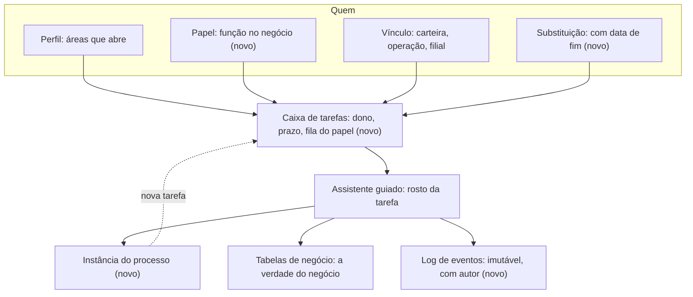
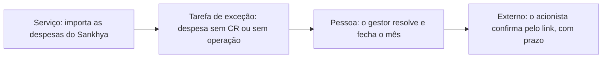
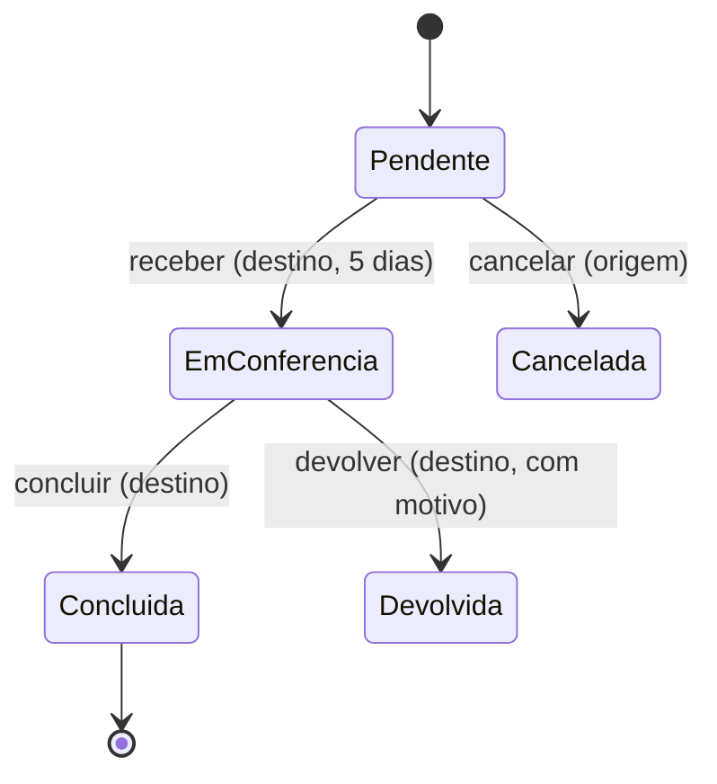

# Gerenciador de processos

Escrito em 11/11/2026 (Alexandre, conversa de planejamento). **Só desenho: nada aqui está construído.** As
hipóteses H1 a H7 estão em `docs/decisoes.md` (11/11/2026) e esperam confirmação. O plano de fatias está
em `docs/superpowers/plans/2026-11-11-processos-e-vinculos.md`.

## Por que existe

O Eixo é a versão 2 da v1. Não copiamos a v1: ela é o gabarito de processos e de regras (`docs/propostas`,
`DIAGNOSTICO_SISTEMA`, dicionário de indicadores). Portamos **regras**, não tabelas. O que a v1 fazia
errado, corrigimos: uma fonte única por etapa, papel rígido por subsistema e "ajuste manual" feito fora do
sistema.

Toda ação em várias etapas (transferir placa, confirmar a carteira, lançar o dia, dar baixa) é um
**processo**: uma tarefa com dono, prazo e histórico. O wizard é a face da tarefa.

## Conceitos

| Conceito | O que é |
| --- | --- |
| Processo | A definição de um fluxo, **versionada e guardada como dado** (não como código). |
| Passo | Uma etapa do processo: quem age, o que preenche, o que vem depois. |
| Transição | A ligação entre dois passos, com a condição que a libera. |
| Instância | Um caso em andamento de um processo. O assunto é uma placa, uma operação ou um mês. |
| Tarefa | A vez de alguém numa instância: uma pessoa ou a fila de um papel num escopo, com `vence_em` e situação. |
| Evento | Linha do log imutável: quem fez o quê, quando, com que dados. Nunca se edita nem se apaga. |
| Delegação (substituição) | De quem, para quem, início, fim e âmbito. Vale só dentro do período. |
| Responsável | A matriz processo × passo × papel × escopo, também versionada. |

## Três vínculos entre pessoa e função, mais a substituição

| Vínculo | Responde | Exemplo |
| --- | --- | --- |
| **Perfil** | Que áreas do sistema a pessoa abre. | Gestor de frota, Operacional, Diretoria |
| **Papel** | A função de negócio. Amplia `config.papel`. | Gestor de frota, líder de operação, operador de pátio, analista de cadastro, financeiro |
| **Vínculo** | Sobre o que a pessoa responde. | Carteira, operação, filial |
| **Substituição** | Quem cobre quem, e por quanto tempo. | Férias: a carteira da pessoa A vai para a B de 10 a 24 |

Perfil abre a porta; papel diz a função; vínculo diz o escopo. A tarefa usa os três.

## Camada por cima do que existe

Legenda: o que leva **(novo)** ainda não existe e nasce nas fatias P1 a P5; o que não leva a marca **já existe** (perfil, vínculo, assistente guiado e as tabelas de negócio).

As tabelas de negócio continuam a verdade do fato: `transferencia`, `custodia`, `chegada`,
`ordem_de_carregamento`, `confirmacao_da_carteira` e `fila_de_excecoes`. As tarefas **nascem dos estados
delas**, sem reescrevê-las. O gerenciador não vira uma segunda fonte do mesmo fato.

Schema novo `processos`, com as tabelas `processo`, `passo`, `transicao`, `instancia`, `tarefa`, `evento` e
`delegacao`. A RLS segue o escopo de quem vê (módulo × ação × escopo, como no resto do Eixo).

Funções atômicas, cada uma com chave de envio (idempotência) e versão (edição concorrente):

| Função | Faz |
| --- | --- |
| `iniciar_processo` | Abre a instância e cria as primeiras tarefas. |
| `avancar` | Conclui a tarefa, grava o evento e cria a próxima. |
| `minhas_tarefas` | Devolve a caixa da pessoa (as dela e as das filas dos papéis dela). |
| `tarefas_da_fila` | Devolve a fila de um papel num escopo. |
| `pegar_tarefa` | Uma pessoa assume uma tarefa da fila. Só uma consegue. |
| `reatribuir` | Troca o dono da tarefa, com motivo. |
| `delegar` | Cria a substituição com período. |

Sem motor BPMN externo agora: o desenho cabe em tabelas e funções do próprio banco.

## O wizard é o rosto da tarefa

- Abre **do cartão da tarefa**, com o contexto já preenchido.
- Cada passo diz **por que você vê isto** e **o que acontece depois**.
- **Rascunho no banco**, não só no navegador: a pessoa retoma em outro computador.
- **Modo rápido** para quem repete a mesma tarefa: faz em lote, com "X de Y" no fim.
- O passo final mostra o **resumo do antes e do depois** e oferece **desfazer** quando for possível.

## Os três tipos de ator

Quem age num processo pode ser de três tipos. Cada um tem o que pode fazer, e a trilha de eventos guarda
sempre o **tipo** e o **autor**.

| Ator | Quem é | Como entra | O que pode |
| --- | --- | --- | --- |
| **Pessoa** | Alguém com login, perfil, papel e vínculo | Login com 2FA | Pega, faz, reatribui (se tiver alçada) e aprova, dentro do escopo |
| **Serviço** | Um worker do Eixo (a ponte do Sankhya, o fechamento agendado) | Chave de serviço **só nos workers** (`service_role` nunca vai ao navegador) | Abre instâncias e cria tarefas a partir de um fato novo; **nunca aprova** nem age em nome de pessoa |
| **Externo** | Quem não tem login: um acionista, um agregado, um cliente | **Link temporário** com prazo, somente leitura ou confirmação de uma coisa só | Ver o que o link mostra e, se o passo permitir, confirmar ou contestar |

Exemplo, de ponta a ponta:

Leitura: o **serviço** só cria a tarefa (o fato é do Sankhya e fica intocado); a **pessoa** resolve a
exceção e fecha o mês; o **externo** confirma o acerto pelo link. Cada passo é um evento imutável, com o
tipo do ator, o autor, a hora e o antes e depois. Prazo vencido do externo **sinaliza** e nunca fecha sozinho
(H4).

## O link temporário, somente leitura

A v1 tinha uma página por token, `/v/[token]`, que mostrava o andamento de uma viagem a quem não tinha
login. O desenho serviu, mas teve três defeitos que o Eixo não repete (lidos no código da v1, só leitura):
a página lia o banco com a **chave mestra**, o token **não tinha prazo** e não ficava registrado **quem viu
o quê**.

No Eixo:

- **Um token por pessoa e por assunto**, aleatório e longo, guardado **com hash** no banco (o texto do
  token só aparece uma vez, ao criar).
- **Prazo obrigatório** (`vence_em`), com revogação a qualquer momento por quem criou e pelo Administrador.
- **Somente leitura por padrão.** Confirmar ou contestar é um passo de processo com **uma ação só**, e
  vira evento com tipo de ator "externo".
- **Escopo mínimo:** o link mostra só o recorte do assunto (por exemplo, o acerto daquele acionista), sem
  CPF, sem documento e sem dado de outras pessoas. O texto da tela vem de uma função do banco que entrega
  só as colunas liberadas; **nada de `service_role` na tela**.
- **Cada abertura é registrada** (hora e resumo, sem dado pessoal) para a trilha e para a mineração de
  processo.
- **Sem indexação** (`noindex`) e sem o token em log, URL de terceiros ou mensagem de erro.
- O link nunca dá acesso ao resto do sistema: não abre sessão.

## Regras

1. A tarefa cai para o **dono do objeto** (carteira, destino).
2. Sem dono, vai para a **fila do papel**, e alguém a pega.
3. **Quatro olhos** em baixa de placa e em acerto: quem pede não aprova.
4. **Trilha de eventos** completa e imutável.
5. **Mineração de processo**: tempo por etapa, prazo vencido e gargalos aparecem no Painel de processos.
6. Prazo vencido **sinaliza e nunca cancela** (H4).
7. O Administrador reatribui, mas não age em nome de ninguém (H5).
8. Notificação primeiro dentro do sistema; e-mail só depois do SMTP (H7).

## Catálogo inicial, por valor

1. Transferência de placa.
2. Confirmação mensal da carteira.
3. Exceções e cadastro pendente.
4. Lançar o dia.
5. Entrega ao Operacional e retorno.
6. Baixa de placa.
7. Trocar CR (ver `docs/vinculos-com-historia.md`).
8. Fechamento mensal da operação.
9. Depois: acerto de acionista (depende da ponte do Sankhya).

Primeiro processo do catálogo, a transferência de placa, desenhada com os estados de
`nucleo.transferencia` (a tarefa nasce de cada estado, sem reescrevê-lo):

Entre parênteses, quem age em cada transição: a origem é o gestor que entrega; o destino, o que recebe.

Prazos iniciais (hipótese H4): receber placa em 5 dias; confirmar a carteira até o dia 5 do mês seguinte;
lançar o dia até as 10h do dia seguinte.

## Telas novas

Todas nascem como esqueleto (ver `docs/esqueleto-global.md`).

- **Início › Tarefas**: a caixa, por pessoa e por fila.
- **Administração › Processos e responsáveis**: a definição dos processos e a matriz de responsáveis.
- **Administração › Painel de processos**: tempo por etapa, prazos vencidos e gargalos.

## O que não muda

A fila atual do plano continua: integrar os branches pendentes, esqueleto global, Lançar o dia +
Movimento, Abastecimento v2 e o resto da Parte B. As fatias P1 a P5 entram no plano sem reescrever o que
já existe (a caixa de Tarefas é a Parte B generalizada).
