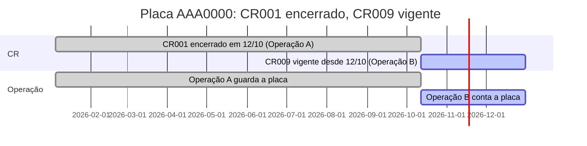

# Vínculos com história

Escrito em 11/11/2026 (regra de Alexandre). **Só desenho: nada aqui está construído.** Complementa a regra
inviolável 1 do `CLAUDE.md` (placa e CPF existem uma vez; o que muda no tempo é o vínculo, com vigência e
sem sobreposição). As hipóteses H1 a H3 estão em `docs/decisoes.md` (11/11/2026) e esperam confirmação.

## O exemplo que define a regra

Em janeiro, o **CR001** estava na placa **AAA0000**. Em outubro, ela passou ao **CR009**, de outra
operação.

- De janeiro até a data da troca, o CR001 estava **válido** e a placa **contava na operação dele**.
- Da data da troca em diante, tudo vai para o **CR009** e para a **operação dele**.
- O CR001 **continua existindo**, com histórico, e **fica gravado na operação** onde esteve.

Exemplo ilustrativo: placa, CRs e datas são inventados para mostrar a regra; não são dados reais.

## As cinco regras

1. **Encerrar não é excluir.** CR, vínculo placa-CR e vínculo CR-operação só se fecham com **data de
   fim**. Corrigir um erro é **outra ação**, com motivo.
2. **Um válido por placa e por tipo de CR.** Frota e acionista podem coexistir (exceção de 06/11/2026);
   dois do mesmo tipo geram alerta e fila (H2).
3. **A placa segue o CR.** A operação da placa é a do CR de frota válido (H1). A montagem manual fica só
   para a placa sem CR.
4. **Trocar CR é uma ação atômica** (`trocar_cr`): fecha o vínculo antigo e abre o novo **na mesma data**,
   sem buraco, com motivo, quem fez e a origem da data. Também move a placa de operação. Troca
   retroativa vira **correção tardia** (H3).
5. **A história pertence à operação.** A operação A guarda a placa até a troca; a B a tem dali em diante.
   Os resultados por mês seguem a vigência.

## Como está hoje no banco

Verificado em `nucleo.cr_do_ativo`, `nucleo.placa_na_operacao` e `nucleo.cr_de_servico_na_operacao`
(migrations `20261103121839_cr_e_operacao`, `20261103182621_operacao_por_montagem`):

- O vínculo **placa-CR já tem vigência** (`cr_do_ativo_um_por_vez`, `EXCLUDE` por placa e período) e
  **nada se apaga** (exclusão lógica com motivo).
- A operação da placa vem de `placa_na_operacao`, montada à parte, também com `EXCLUDE`. Ela **pode
  divergir do CR**.
- `cr_de_servico_na_operacao` liga **só CR de serviço** a uma operação, com vigência.

## O que falta

| # | Falta | Hoje |
| --- | --- | --- |
| i | A operação acompanhar o CR | A operação da placa e o CR andam separados e podem divergir |
| ii | O assistente atômico **Trocar CR** | Não existe: troca-se fechando e abrindo à mão |
| iii | A trava de um válido por tipo | Saiu na 3.9c e hoje só alerta; os 9 casos legados de dois do mesmo tipo seguem sem recusa |
| iv | Mostrar a história na operação | A ficha da operação não mostra os CRs e placas que passaram por ela |

## Caminho de menor risco (proposta)

Não derrubar `placa_na_operacao` de uma vez. Em passos, cada um reversível:

1. **Generalizar `cr_de_servico_na_operacao` para todo CR com vigência** (frota, acionista e serviço),
   mantendo a tabela e o `EXCLUDE` que já existem. Alternativa mais limpa e mais cara: tabela nova
   `cr_na_operacao`. A recomendação é generalizar: não cria tabela, não muda a restrição de banco que já
   foi provada.
2. **Preencher a partir do que existe**, sem perder a montagem: para cada CR de frota ou acionista com
   placas, gravar o vínculo CR-operação com a vigência e a operação que as placas dele já têm em
   `placa_na_operacao`. A montagem atual continua intacta.
3. **Visão de divergência** (só leitura): lista as placas cuja operação em `placa_na_operacao` difere da
   do CR válido. Vira alerta e fila de exceção; ninguém é recusado. A equipe resolve a lista.
4. **`trocar_cr`** grava os dois lados na mesma transação (vínculo placa-CR e, por consequência, a
   operação da placa), com chave de envio e versão.
5. **Por último**, quando a divergência chegar a zero, `placa_na_operacao` passa a ser derivada do CR
   (visão de compatibilidade), e a montagem manual fica só para placa sem CR.

Cada passo é uma migration própria, com pgTAP, e **a fatia V0 só fecha antes de qualquer carga real na
nuvem** (ver o plano).

## Visual

Dois tokens semânticos, **suaves** (o encerrado **não** usa o tom de erro):

| Token | Cor | Rótulo e ícone |
| --- | --- | --- |
| `vigente` | Verde | "Vigente desde 12/10", com ícone de relógio ativo |
| `encerrado` | Vermelho claro e suave | "Encerrado em 12/10", com ícone de ponto final |

Regras: **nunca só pela cor**; rótulo e ícone sempre; contraste **AA** nos temas claro e escuro, com
teste. Os tokens vivem nos tokens do Eixo (nada de cor escrita à mão).

Onde aparece:

- **Ficha da operação:** placas e CRs com as datas e as duas cores; filtro "só vigentes" ou "incluir
  histórico".
- **Ficha da placa, aba CRs.**
- **Ficha do CR (nova):** as placas e as operações que ele teve.
- **Listas** com a opção "Incluir histórico".

## Critério de aceite

- **pgTAP:** `trocar_cr` é atômico; sem buraco entre o fim e o início; nada é apagado; a operação da placa
  muda na data; a operação A tem a placa até a troca e a B depois; o resultado do mês acompanha; RLS com
  usuário de cada perfil.
- **e2e** do caminho principal (trocar o CR de uma placa e ver a história nas duas operações).
- **Teste** de rótulo, ícone e contraste dos dois tokens, nos dois temas.
